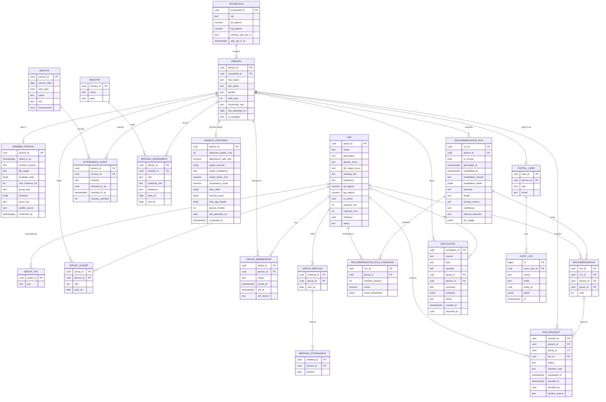

# Gathered: Data Model & Architecture
**Version 0.5 · 2026-11-07 · Canonical build specification** for the Gathered entry to the AI for Church Hackathon 2026.
**Companions:** `Gathered - Demo Journeys.md` (build plan, slices and journeys) · `AI for Church Hackathon - Submission Deliverables.md` (submission fields and safeguards checklist)

**How to use this document**
- If code and this document disagree, this document wins. Change a decision here first, then in code.
- Decision IDs (W1–W17, D1–D7) and section numbers §3b, §5 and §10 are cited from code comments. Keep them stable.
- Naming is generic on purpose: Manager / Leader / Member, and "group" rather than "D-Group" in the schema, so the model carries over outside church settings.

---

## 0 · Decisions

### 0.1 · Product and architecture decisions (W1–W17)

| # | Decision |
|---|---|
| W1 | **Giving data is out.** It is not collected and not modeled. |
| W2 | **Group meetings and attendance stay in the model.** They are visible to the **Manager only**. They can inform recommendations but are never shown in them. |
| W3 | **Members see no reasoning about themselves.** There is no member-facing explanation of any kind: no "why it fits" or "why you fit" text, no attendance, no person attributes. The member sees group cards (public group facts only, identical for every member) and judges the fit themselves. *Presentation guardrail: "Gathered recommends; the member decides. It never explains a recommendation in terms of a person."* The deterministic score, the score breakdown and the internal rationale are stored for audit and are visible to the Manager only, enforced in the database (§4). See *Terminology* in §5.6. |
| W4 | **Minimal CRUD.** Groups, leaders, history and personas are seeded. The only **user-initiated** writes are: member intake confirmation, member join request, leader accept or decline, manager acknowledge or resolve of an escalation. **System writes** that follow from those actions are also allowed: recommendation runs and their invalidation (§6), escalation inserts, and audit-log rows. |
| W5 | **Mock auth.** A landing page lists the seeded personas. Choosing one "logs in" as that person, and every request carries that persona's role and person ID into Postgres as the row-level security context. |
| W6 | **Three views.** Manager: group data and escalations. Leader: their own groups, recent joiners, open requests. Member: not in a group → recommendations; in an active group → that group's details only. |
| W7 | **Hosting:** Vercel free tier. **Data platform:** Databricks Free Edition. **Operational store:** Lakebase Postgres (chosen after the validation spike in §10.1). |
| W8 | **Escalations in the demo:** #1 hidden schedule conflict and #3 unmet demand / start a group. #2 and #4 are out of demo scope (§8). |
| W9 | **Recommendation matching is hybrid.** Deterministic hard filters, then a deterministic weighted score, reduce the eligible groups to a shortlist of up to about 6. **Claude Haiku via OpenRouter** then selects and orders the final top 3 from that shortlist by comparing the member's own words and stated preferences with each group's description and tags. The LLM returns group IDs plus an **internal rationale**. It can never add a group that is not on the shortlist. See §5. |
| W10 | **The internal rationale is Manager-audit only.** It never reaches a Leader or a Member. Leaders see only what the member chose to submit with a request. *Example of what must never surface to a leader:* "Joey would be great here; he's recently divorced and lonely." The ranking prompt is told to reference group facts and the member's stated preferences only, and the Manager's audit view shows the rationale so the demo can open the hood. |
| W11 | **Groups meet at the leader's home** (business rule). Group location = the leader's household location. **Hard filter: the member's household is within 5 miles** (haversine on approximate coordinates), unless the group is online. Members see the general area, never an address. |
| W12 | **Seed geography: Winter Garden, FL (west of Orlando)**, using zips 34787, 34786, 34761, 34734 and 34711. Households get the zip centroid plus random jitter. No real addresses. |
| W13 | **Defaults:** group cards show public group facts only (the same for every member); one-screen LLM-assisted intake with member confirmation; one-button leader accept/decline; Claude Haiku via OpenRouter for intake and ranking, Claude Sonnet for escalation review. |
| W14 | **Recommendation sets are persisted and reused.** A generated set is stored in Lakebase. Rendering or refreshing a recommendation page never by itself invokes the LLM: when a current set exists and its matching inputs remain valid, the stored set is returned with zero ranking LLM calls. Matching-relevant data changes **invalidate** affected sets but do not themselves call the LLM. A new set is generated only when an eligible member next requests recommendations and no valid current set exists. See §6. |
| W15 | **Recommendation eligibility.** Only opted-in members (a `member_profile` exists) with **no active group membership** receive recommendations. A member with an active membership sees their group instead (W6). |
| W16 | **A recommendation run is a first-class record.** One run is one generation event for one member. It owns the ordered recommendation rows, the **complete deterministic shortlist** that fed the ranking, the model and prompt version, and its current/invalid state with a timestamp and reason. Runs are never overwritten or deleted: historical runs stay for the Manager's audit. A completed attempt with zero eligible groups is a valid **empty run**, reused on later visits. See §6.5. |
| W17 | **Invalidation is explicit and database-owned.** Matching-relevant changes mark affected current runs invalid, in the same transaction as the change, through narrowly scoped `SECURITY DEFINER` triggers. Invalidation never calls the LLM and never generates recommendations; regeneration stays lazy (W14). Changing the ranking prompt version also invalidates runs created under the previous version, again without regenerating. Normal Leader row-level security is not widened to allow any of this. See §6.6. |

### 0.2 · Foundation decisions (D1–D7)

| # | Decision | Why |
|---|---|---|
| D1 | **Two stores.** Lakebase Postgres is the system of record for operational state: groups, memberships, join requests, member profiles, recommendation runs, escalations and the audit log. Databricks holds engagement history (attendance signals, serving) and computes the slower-moving `person_features`, which a nightly job writes into Lakebase. **Databricks does not rank recommendations.** | This is the usual split between an operational app database and an analytical platform. Join requests and accepts need enforced keys, transactions and row-level security, which a warehouse doesn't give a web app. |
| D2 | **Recommendations are generated on demand and persisted** (W14). A set is generated the first time an eligible member asks and no valid set exists. It is stored as a run with its ranked rows, reused on every later view, and invalidated when matching-relevant data changes (§6). | A change to a group (for example, someone joins) has to affect the next recommendation immediately, which rules out a nightly batch. Persisting the result keeps page views free of LLM calls and makes every run auditable. |
| D3 | **Matching is hybrid and constrained** (W9). Deterministic code decides who is eligible and which groups pass the hard filters, and scores them into a shortlist. The LLM only selects and orders within that shortlist, and its output is validated against it. The LLM never explains a recommendation to the member (W3). The other LLM jobs are intake (free text → proposed profile fields) and escalation review (§7). | The safety-critical constraints (schedule, distance, gender focus, open seats, opt-in) stay deterministic and testable. The LLM adds judgment where a fixed score can't read the member's own words; the evaluation in §10.2 measured that gain. |
| D4 | **Giving data is not in the model at all** (W1). | Simpler and stronger than masking it. |
| D5 | **Permissions are enforced with Postgres row-level security.** Every request runs in a transaction that sets `app.role` and `app.person_id` (via `set_config(..., true)`) on the shared `gathered_app` login role. Policies key on those settings; column grants and two `SECURITY DEFINER` functions cover what row policies can't hide (§4). | Permissions are enforced where the data lives, not in the UI. |
| D6 | **Synthetic church only.** Every person row is flagged `is_synthetic = true`. | Hackathon rule and a project safeguard. |
| D7 | **Children are person rows with `household_role = 'child'`** and no portal account. | Needed for kids-age matching without a separate table. |

---

## 1 · The layers

```
┌────────────────────────────────────────────────────────────────────┐
│ PORTAL (Next.js on Vercel)        Member · Leader · Manager        │
│   server code only ──► OpenRouter (Haiku: intake, ranking;         │
│                                    Sonnet: escalation review)      │
│   withPersona(): one transaction per request, sets app.role and    │
│                  app.person_id, connects as gathered_app           │
├────────────────────────────────────────────────────────────────────┤
│ OPERATIONAL STORE (Lakebase Postgres 17, schema app, RLS)          │
│   groups · memberships · join requests · member profiles           │
│   recommendation runs + ranked rows · escalations · audit log      │
│   person_features (written nightly from Databricks)                │
│   fn group_card() · fn manager_recommendation_audit()              │
│   deterministic shortlist (filters + score), added in Slice 1      │
├──────────────▲─────────────────────────────────────────────────────┤
│              │ nightly: person_features written into Lakebase      │
│ DATA PLATFORM (Databricks Free Edition, Delta tables)              │
│   attendance events · serving assignments · services · ministries  │
│   notebook: compute person_features                                │
└────────────────────────────────────────────────────────────────────┘
```

- **Where state lives:** current group, membership, profile and recommendation state is operational data in Lakebase. Databricks computes `person_features` only; it holds no recommendation state and does no ranking.
- **Feature sync:** the nightly Databricks notebook writes `person_features` into Lakebase with a plain insert. Lakebase synced tables (Delta → Postgres) are untested in Free Edition and not required (§10.1, P5).
- **Rule-based escalations** run in the app (server code), not in Databricks (§8).

---

## 2 · Entity diagram

The Mermaid source below is authoritative. `Gathered - ER Diagram.png` is a rendering of an earlier version and may lag it. The diagram shows the logical model; the Lakebase tables are defined in `migrations/0001_app_schema.sql`, and the engagement tables (`service`, `attendance_event`, `ministry`, `serving_assignment`) live in Databricks (§3b).



The recommendation run, its shortlist candidates and the slimmed `recommendation` table are the Slice 1 schema (migration `0004`, designed in §6.5). Until that migration is applied, the deployed `recommendation` table still has the older single-table shape.

---

## 3 · Tables by layer

### 3a · People (operational, seeded)
- **household:** location is **approximate** (zip centroid plus jitter), never a street address. `checkin_app_opt_in` records consent for the church-app arrival signal (§3b).
- **person:** adults and children. `household_role` = `adult` | `child`. `gender` is used only to honor gender-focused groups (D-Groups are often same-gender).
- **member_profile:** exists **only if the person opted in**. Everything the matcher uses about preferences comes from here, in the member's own words or confirmed by them.
  - `life_stage`: self-reported: `single` · `married_no_kids` · `young_kids` · `school_age_kids` · `teens` · `empty_nest` · `retired`.
  - `available_slots`: e.g. `{sun_pm, tue_eve, thu_am}`. `group_pref`: `men` · `women` · `mixed` · `couples`.
  - `about_me`: free text, saved word for word. The LLM proposes structured fields from it and the member confirms them (`profile_source = 'llm_confirmed'`).
- **portal_user:** `role` = `member` · `leader` · `manager`. A leader is also a member.

### 3b · Engagement (data platform, 26 weeks of seeded history)
**Principle:** a church never sees everyone who attends. Attendance is a set of *signals* with uneven coverage, and **no signal is not absence**.

| Channel (`attendance_event.channel`) | What it records | Who it covers |
|---|---|---|
| `kiosk` | Child check-in. `person_id` = child, `checked_in_by` = the adult who checked them in | Families with kids ≤12 who use the kiosk (seed: about 88% of those families) |
| `app_geofence` | An "arrived on campus" event from the church app | Only households with `household.checkin_app_opt_in = true` (seed: about 21%). Consent is recorded and **no location trail is stored**, only the arrival event |
| `serving_roster` | The adult was rostered to serve that slot (serving implies presence) | Volunteers (weekly, biweekly or monthly) |
| `livestream` | A logged-in viewing session with `minutes_watched`; one row per household | Online and hybrid households. It counts as attended at **20+ minutes** |

- **Not modeled:** usher headcounts (anonymous) and connect cards. We do **not** assume every family has a geofenced app.
- **Seed reality:** 120 of 331 adults (36%) leave no attendance trace at all, even though many attend. Examples: the spouse who didn't check the kids in, singles without the app, the second adult in a livestream household.
- **Tables:**
  - `service`: two Sunday services (9:00, and 11:00, which is livestreamed) and Wednesday night. Includes `slot` and `livestreamed`.
  - `attendance_event`: `person_id`, `service_id`, `channel`, `checked_in_by`, `checked_in_at`, `minutes_watched`.
  - `ministry`, `serving_assignment`: `schedule_slot` (e.g. `sun_11`) is what makes the "kids-ministry volunteer arrives late" conflict detectable.
- **person_features** (derived nightly in Databricks, written into Lakebase):
  - `observed_weeks_12w`: weeks with any signal, counting the adult on a kiosk row's `checked_in_by`
  - `attendance_rate_12w`: of observed signals only
  - `signal_sources`: the channels seen for this person
  - **`signal_confidence`**:
    - `high`: any kiosk, app or weekly-serving signal in the last 8 weeks
    - `medium`: livestream or occasional serving only
    - `low`: no signals
  - `online_share_12w`: share of observed weeks that were livestream
  - `consistency_score`, `busy_slots`, `serving_areas`, `kids_age_bands`, `tenure_months`, `last_attended_on`
- **Matching guardrail:**
  - The consistency factor (15 points, §5.3) applies **only at `high` or `medium` confidence**. At `low` it scores neutral (7.5).
  - A low observed rate is never treated as low commitment.
  - `online_share_12w` ≥ 0.75 marks an **online-first** member: online groups stay eligible, and the manager dashboard can show "online-first households within 5 miles of an in-person group."
- **Validation data:** `_truth_household.csv` and `_truth_person.csv` hold the generator's hidden truth (online mode, kiosk use, propensity, drift). They are used to check that the features notebook recovers it, and are **never loaded into the app**.

### 3c · Groups (operational)
- **grp:** `status` = `forming` · `open` · `full` · `closed` · `multiplying`. `capacity_max` defaults to 8 and `capacity_min` to 3 (D-Group sizing).
- **group_tag:** free-form tags the manager adds ("new to faith," "Bible-reading plan," "dads," "recovery-friendly").
- **group_leader**, **group_membership:** a membership is `active` or `left`. Membership is what changes a group's makeup, and a membership change is a material change for recommendations (§6.3).
- **group_meeting**, **meeting_attendance:** kept in the model (W2), Manager-only. They feed the 12-week meeting attendance rate on the Manager's groups table and the "group shrinking" style of escalation.

### 3d · Workflow and governance (operational)
- **recommendation_run:** one generation event for one member (W16). Holds provenance (`model`, `prompt_version`, `confidence`, `outcome`, `llm_usage`), the Manager-only `internal_rationale`, and validity (`is_current`, `invalidated_at`, `invalidation_reason`, `invalidation_detail`). Details in §6.5.
- **recommendation_run_candidate:** the complete deterministic shortlist for a run: group, shortlist position, `score` and `score_breakdown`. Kept in full because a change to a shortlisted group can invalidate the run even if the group did not reach the top 3.
- **recommendation:** the final ordered result of a run: `run_id`, `person_id`, `group_id`, `rank` (1–3) and nothing else. This is all a member can read about a recommendation. A database constraint ties each row to a candidate of the same run, so a recommended group is always a shortlisted group.
  - *Naming:* earlier drafts called the rationale column `why_text`. It is now `internal_rationale`, on the run, because the LLM returns one rationale for the whole set.
- **join_request:** `status` = `requested` · `accepted` · `declined` · `withdrawn` · `expired`. `rec_id` links a request to the recommendation row it came from, if any. Accepting a request inserts the membership in the same transaction.
- **escalation:** `source` = `rule` | `ai`; `status` = `open` · `acknowledged` · `resolved`.
  - `evidence` stores the facts the escalation was built from. AI escalations also store the model and prompt version.
- **audit_log:** every accept, decline, profile confirmation, escalation acknowledge or resolve, and every LLM call (§7).

### 3e · Derived group profile
Computed from active memberships joined to `person_features` and `member_profile`:
- headcount and open seats
- life-stage mix and kids-age-band mix
- serving areas represented
- median consistency
- the meeting slot

This is what lets a group's makeup affect matching. When the first dad of toddlers joins an empty forming group, the group's kids-age mix changes from `{}` to `{0-4}`. That membership change invalidates the affected recommendation runs (§6.3), and the next dad of toddlers who asks for recommendations gets a fresh run in which that group scores higher. No batch job is needed.

---

## 4 · Who sees what (row-level security)

| Data | Member | Leader | Manager |
|---|---|---|---|
| Own profile | ✔ read/write | ✔ (as a member) | ✔ all |
| Own current recommendations: which groups, in what order | ✔ read | ✔ (as a member) | ✔ all, including invalidated runs |
| Own join requests | ✔ read/create | ✔ (as a member) | ✔ all |
| Public group card (name, description, tags, slot, area, open seats, childcare) | ✔ | ✔ | ✔ |
| A group's member list | ✖ | **own groups only** | ✔ all |
| Join requests to a group | ✖ | **requests to own groups** | ✔ all |
| A requester's name and their own request note | ✖ | **only while the request to the leader's group is pending** | ✔ |
| Any `member_profile` other than one's own | ✖ | ✖ (never, not even for a pending requester) | ✔ |
| Engagement history, service attendance, `person_features`, **group meeting attendance** | ✖ | ✖ | ✔ |
| Recommendation score, score breakdown, shortlist, internal rationale, model, prompt version, confidence, invalidation history | ✖ | ✖ | ✔ audit only, via `app.manager_recommendation_audit()` |
| Escalations | ✖ | about own groups | ✔ all |

**How it's enforced** (`migrations/0002_rls_policies.sql`, `0003_security_definer_functions.sql`):
- Row policies key on `app._role()` and `app._person()`, which read the per-transaction settings.
- `app.group_card()` is the only read path for group cards. `gathered_app` has no grant on group coordinates, so there is no base-table path to a location.
- `gathered_app` has no grant on `recommendation_run_candidate` at all, and only a column-limited grant on `recommendation_run` (run ID, person, `is_current`, `generated_at`). The `recommendation` table carries only run, person, group and rank. Score, breakdown, rationale and provenance are therefore unreadable by every persona through any query, including the Manager's. `app.manager_recommendation_audit()` is the only way back to them, and it raises an error unless `app.role = 'manager'`.
- Nobody can write recommendation tables directly. Runs are created by `app.persist_recommendation_run()` and invalidated by triggers (§6.6), both `SECURITY DEFINER`.

The demo proves this with a Leader-vs-Manager comparison of the same group page (Journey 5).

---

## 5 · Matching v1 (hybrid, constrained, auditable)

The pipeline: **eligibility → hard filters → weighted score → shortlist (up to ~6) → LLM top 3 → validate → persist.** Everything before the LLM is deterministic. The LLM only chooses and orders within the shortlist.

### 5.1 · Eligibility (W15)
A member is eligible for recommendations only if:
- they have an opted-in `member_profile`, and
- they have **no active group membership**.

A member with an active membership sees their group (Journey 6) and is never sent through matching.

### 5.2 · Hard filters (a group is excluded if any fail)
- **Seats:** group status is `forming` or `open`, and active members < `capacity_max`.
- **Gender focus:** compatible with the person.
- **Schedule:** the meeting slot is in the person's `available_slots` **and** not in their `busy_slots`.
- **Distance:** the member's household is within **5 miles of the leader's household** (W11), unless the group is online.

### 5.3 · Weighted score (0–100)

| Factor | Points | Source |
|---|---|---|
| Life stage matches the group's declared focus, or its current members' mix | 30 | profile vs the derived group profile (§3e) |
| Kids-age overlap with current members | 20 | `kids_age_bands` |
| Shared serving area with a member or leader | 15 | `serving_areas` |
| Consistency similar to the group's median | 15 | `consistency_score` (neutral 7.5 at `low` signal confidence, §3b) |
| Interest or tag overlap | 10 | `interests` vs `group_tag` |
| Distance within the 5-mile radius (closer is better) | 10 | approximate coordinates of member vs leader household |

- **Groups with no declared focus and no members** score life stage neutral (15), so new forming groups still get recommended. A declared `life_stage_focus` takes precedence over the member mix.
- **Online groups** are exempt from the distance filter and score 5 of the 10 distance points.
- The score and its per-factor breakdown are stored with every recommendation row.

### 5.4 · Shortlist
The top groups by score, **up to 6**, go to the LLM. If fewer than 6 pass the filters, all of them go. If none pass, there is nothing to rank: the member sees the empty state, and that situation feeds the unmet-demand escalation (§8, #3).

### 5.5 · LLM ranking (Claude Haiku via OpenRouter)
- **Input:** the member's `life_stage`, `group_pref`, `interests` and `about_me` (no name, attendance or address), and for each shortlisted group its public facts, an aggregated member mix (counts only) and its score. Full prompt contract: Demo Journeys, *Recommendation Model Evaluation*.
- **Output** (zod-validated): `ranked[]` of `{group_id, rank}`, an `internal_rationale` of 60 words or fewer, and a `confidence` of `high` · `medium` · `low`.
- **Validation:** every `group_id` must come from the shortlist, with no duplicates and exactly `min(3, n)` items. On failure, retry once. If the retry also fails, fall back to the score order and record that the fallback was used.
- **Prompt rules:** base the choice on the member's own words and stated preferences compared with group descriptions and tags. Never infer or mention anything about the member's spiritual state, marriage, health or struggles. The rationale refers to group facts and stated preferences only (W10).
- **Prompt versions:** `rank-v1` is evaluated (§10.2). **Slice 1 ships `rank-v2`**, which adds each group's `status` and `open_seats` to the shortlist input (the fix suggested by the evaluation) and is re-evaluated before it ships. A change of prompt version invalidates runs created under the previous one (W17).

### 5.6 · What is stored, and terminology
- **Stored per run:** the shortlist with scores and breakdowns, the ranked rows, the internal rationale, model, prompt version, confidence and generation time (§6.5).
- **Terminology** (use these terms consistently):
  - **Group card:** the public facts about a group. The only thing a member sees about a recommended group, identical for every member.
  - **Member-facing explanation:** does not exist. Gathered never tells a member why a group was recommended (W3). Older drafts' "why it fits" text was removed.
  - **Score breakdown:** the deterministic per-factor points. Manager audit only.
  - **Internal rationale:** the LLM's short audit note on its ranking. Manager audit only (W10). Never shown to a member or leader, and never used as a member-facing explanation.

---

## 6 · Recommendation lifecycle (W14)

### 6.1 · Flow
```
eligible member requests recommendations
        │
        ▼
valid current run stored? ──yes──► return the stored run (0 ranking LLM calls)
        │ no
        ▼
hard filters → score → shortlist (deterministic, §5.1–5.4)
        │
        ▼
Haiku ranks top 3 within the shortlist → validate (retry / score fallback)
        │
        ▼
persist the run and its ranked rows + audit_log row → return it
```
After that, every view reuses the stored run until a material change invalidates it.

### 6.2 · Rules
- Rendering, revisiting or refreshing a recommendation page **never by itself** calls the LLM.
- A valid current run is returned with **zero ranking LLM calls**.
- A matching-relevant change **invalidates** affected runs and makes **no** LLM call.
- Regeneration is lazy: it happens only when an eligible member next requests recommendations and no valid current run exists.
- Members who are not eligible (§5.1) never trigger generation. When a member joins a group, their own runs stop being shown; they see their group.
- A completed attempt with **no eligible groups** creates a valid **empty run** (no LLM call, nothing to rank). Revisits reuse it. A later material change can invalidate it, and the next request retries.
- A ranking **prompt-version change** invalidates current runs made under the previous version, with no LLM call. They regenerate under the new version on the member's next request.
- Runs are never deleted. Invalidated runs stay available to the Manager's audit view, which is how Journey 5 shows "before and after."

### 6.3 · Material changes
A change is **material** if it can change who is eligible, which groups pass the hard filters, or how they score or rank.

| Change | Runs to invalidate (practical scope) |
|---|---|
| Member confirms or changes matching preferences / profile (intake) | That member's run |
| Matching-relevant `person_features` change (e.g. `busy_slots`, `kids_age_bands`, `serving_areas`, `consistency_score`, `signal_confidence`, `online_share_12w`) | That person's run; and, if they are in a group, runs that shortlisted that group (its mix changed) |
| An eligible group is added | All current runs (the new group may pass anyone's filters) |
| Group status changes into or out of `forming` / `open` (e.g. to `full` or `closed`) | Runs that shortlisted the group; if it became `forming`/`open`, all current runs |
| Capacity or seat availability changes | Runs that shortlisted the group; if seats opened up, all current runs |
| Active membership changes (someone joins or leaves) | The person's own run (eligibility changed), and runs that shortlisted the group (seats and mix changed) |
| Group schedule changes | Runs that shortlisted the group, and runs of members whose `available_slots` include the new slot |
| Group focus, tags or description change | Runs that shortlisted the group; for a gender-focus change, all current runs |
| Leader or location changes that affect distance or eligibility | Runs that shortlisted the group, and all current runs if the group may now be within someone's radius |

- **Scope:** invalidate by **shortlist membership**, not just the top 3, because a group anywhere on the shortlist can move into the top 3 after a change. Where a change can make a group newly eligible for members who never saw it, invalidating all current runs is acceptable: it costs no LLM calls until each member returns.
- **Not material:** page views, creating a join request (a pending request holds no seat), escalation activity, raw attendance events (they matter only through `person_features`).

### 6.4 · Audit
- Every generation writes an `audit_log` row: purpose `rank`, model, prompt version, token counts, latency, whether retry or fallback was used, and the run it produced. It never contains the full prompt when that includes `about_me`.
- Reusing a stored run makes no LLM call and writes no ranking audit row. Counting ranking audit rows is how Slice 1 proves that a page view cost zero calls.
- The Manager's audit view lists every run for a member, including invalidated runs and why they were invalidated.

### 6.5 · Data model: the recommendation run
Adopted for Slice 1 (migration `0004`). All three tables are written only by `SECURITY DEFINER` functions and triggers.

**`recommendation_run`**: one generation event for one member.

| Column | Purpose |
|---|---|
| `run_id` | Primary key |
| `person_id` | The member |
| `generated_at` | When the run was produced |
| `is_current` | `true` while the run is valid. At most one current run per member (partial unique index) |
| `invalidated_at`, `invalidation_reason`, `invalidation_detail` | Set together when `is_current` becomes `false`. Reason is one of: `profile_changed` · `person_features_changed` · `membership_changed` · `group_added` · `group_changed` · `group_tags_changed` · `group_leader_changed` · `location_changed` · `prompt_version_changed` · `superseded`. `detail` names the group or person that triggered it |
| `outcome` | `llm` · `llm_after_retry` · `score_fallback` · `no_candidates` |
| `model`, `prompt_version`, `confidence` | Provenance. Null for `no_candidates`, which involves no ranking |
| `internal_rationale` | The LLM's audit note for the whole set (W10). Null for `no_candidates`; a fallback note for `score_fallback` |
| `llm_usage` | Token counts, latency and attempts, for the audit view |

**`recommendation_run_candidate`**: the full deterministic shortlist of a run: `(run_id, group_id)` key, `shortlist_position`, `score`, `score_breakdown`. Indexed by `group_id` so invalidation can find every run that shortlisted a changed group.

**`recommendation`**: the ordered result: `rec_id`, `run_id`, `person_id`, `group_id`, `rank`. Constraints: `(run_id, rank)` and `(run_id, group_id)` unique; `rank` between 1 and 3; a foreign key `(run_id, group_id)` → `recommendation_run_candidate`, so the database itself enforces that a recommended group was on the shortlist; `(run_id, person_id)` → `recommendation_run` keeps the person consistent. `join_request.rec_id` still references a recommendation row.

**Empty run:** a run with `outcome = 'no_candidates'`, no candidates and no recommendation rows.

**Functions** (all `SECURITY DEFINER`, pinned `search_path`, `execute` granted to `gathered_app` only):
- `app.current_recommendation_run(prompt_version)`: for the caller. Returns the member's state: ineligible (no profile, or in a group), a current run, or none. If the current run was made under a different prompt version, it invalidates it (`prompt_version_changed`) and returns none. Never calls the LLM.
- `app.recommendation_shortlist()`: the deterministic stage for the caller (§5.1–5.4). Returns up to 6 candidates with score, breakdown and the group facts the ranking prompt needs, including aggregated group mix, `status` and `open_seats`. Returns nothing for an ineligible caller.
- `app.persist_recommendation_run(...)`: takes the shortlist IDs the LLM saw, the ordered ranked IDs, outcome, confidence, rationale, model, prompt version and usage. Under a per-member lock it recomputes the shortlist, rejects the write if the shortlist changed since the LLM saw it (`shortlist_changed`) or if the ranking is not an ordered subset of it, marks any existing current run `superseded`, and writes the run, candidates and rows. Scores and breakdowns always come from the database, never from the caller.
- `app.manager_recommendation_audit()`: returns every run for a member (or every run that shortlisted a group), including invalidated ones, one row per shortlisted group with its score, breakdown, rank if recommended, and the run's provenance, rationale and invalidation history. Raises an error for non-managers.

### 6.6 · Invalidation mechanism
**Database triggers**, not application code and not per-endpoint functions.

- **Why triggers:** material changes arrive from several writers: the app (profile confirmation, leader accept), the nightly `person_features` job, seed and admin scripts, and future write paths. A trigger fires for all of them, in the same transaction as the change, so a change can never commit without invalidating. There is no invalidation business logic in Next.js to keep in sync.
- **Why `SECURITY DEFINER`:** a leader's accept must invalidate other members' runs, which the leader's row-level security (correctly) forbids. The trigger functions run with owner rights and do exactly one thing: call a single internal helper, `app._invalidate_runs(reason, detail, person_ids, group_ids, all_current)`, which flips `is_current`. `gathered_app` has no `update` grant on the run tables and no `execute` grant on that helper.
- **Triggers** (`AFTER ... FOR EACH ROW`, firing only when a matching-relevant column actually changes, so a nightly recompute that produces identical values invalidates nothing):

| Source table | Fires on | Invalidates |
|---|---|---|
| `member_profile` | insert, delete, update of `life_stage`, `available_slots`, `group_pref`, `interests`, `about_me` | The member's run |
| `group_membership` | insert, delete, update of `status` | The member's run; runs whose shortlist contains the group |
| `person_features` | insert, delete, update of `busy_slots`, `kids_age_bands`, `serving_areas`, `consistency_score`, `signal_confidence`, `online_share_12w` | The person's run; if the person is in a group, runs shortlisting that group |
| `grp` | insert | All current runs |
| `grp` | update of `status`, `capacity_max`, `meeting_slot`, `gender_focus`, `life_stage_focus`, `is_online`, `description`, `childcare`, coordinates | Runs shortlisting the group; plus **all current runs** when the change can make the group newly eligible (status into `forming`/`open`, more capacity, or a new slot, gender focus, online flag or coordinates) |
| `group_tag` | insert, update, delete | Runs shortlisting the group, and runs of members whose interests include the tag |
| `group_leader` | insert, update, delete | All current runs (the group's location or existence changed) |
| `household` | update of coordinates or zip | The residents' runs; all current runs if a group leader lives there |
| `person` | update of `gender` or `household_id` | The person's run |

- **Known approximation:** shortlist-scoped invalidation does not re-score groups that were never on a member's shortlist. A change to a *non-shortlisted* group's members could in theory lift it into the top 6. The cases that can newly admit a group (the "all current runs" rows) are covered; anything subtler is accepted for the MVP and is picked up at the next material change.
- **Prompt-version change:** handled by `current_recommendation_run`, as above, because it is a deployment event rather than a data write. A deploy step can also flip all stale runs eagerly.
- **Audit:** every invalidation is visible to the Manager audit (reason, detail, time) on the run itself.

### 6.7 · Concurrency
Two simultaneous first requests may both reach the LLM. The per-member lock in `persist_recommendation_run` makes the second writer supersede the first, and the partial unique index guarantees one current run per member. The cost of the race is one wasted ranking call, never inconsistent state. A material change that lands between shortlist and persist is caught by the `shortlist_changed` check, and the application retries the whole flow once.

---

## 7 · Where the LLM is used (three jobs, all server-side)

| Job | Model | Trigger | Input | Output | Guardrail |
|---|---|---|---|---|---|
| **Intake** | Haiku | Member submits "about me" | Free text | Proposed profile fields (zod schema: `life_stage`, `available_slots`, `group_pref`, `interests`) | Allowed values only. The member confirms every field; nothing is saved unconfirmed. Personal details never become profile fields |
| **Recommendation ranking** | Haiku | An eligible member requests recommendations and no valid run exists (§6) | Member preferences and own words + the deterministic shortlist (§5.5) | Top `min(3, n)` group IDs from the shortlist, internal rationale, confidence | Shortlist-only, validated, retry then score fallback. Rationale is Manager-only. Never runs on a plain page view |
| **Escalation review** | Sonnet | Manager runs the review (Journey 4) | Structured facts + group description + the member's request note and `about_me` | `{raise, kind, severity, summary, evidence[]}` | Advisory only; the Manager decides |

- **Every LLM call** goes to OpenRouter from server code (the key never reaches the browser) and writes an `audit_log` row with purpose, model, prompt version and token counts.
- **Library:** the OpenAI-compatible SDK pointed at OpenRouter, with zod schemas for structured output. **No LangChain:** these are single-shot structured calls with no agent loop.

---

## 8 · Escalations

**Rule-based** (deterministic checks, run by the Manager's review action):
- Group below `capacity_min` for 4+ weeks
- Join request undecided after 7 days
- Group full while requests keep arriving
- Leader leads more than 2 groups

**AI-reviewed** (cases rules can't read):
1. **Hidden schedule conflict.** The group description says "we meet right after second service," and the requester serves in kids' ministry at 11:00, or wrote "I help in the nursery most Sundays" in `about_me`. Neither is a clean structured slot match, so the LLM reads both texts plus `busy_slots`. *The Manager gets:* "Marcus may arrive 30–40 min late every week."
2. **Needs care, not just a group.** Out of MVP scope (see §12). A future version could route a member's own words that suggest a crisis or a pastoral need to the Manager, without storing a label on the person.
3. **Unmet demand, or a group to start.**
   - Clusters opted-in members with no eligible group ("6 moms of toddlers want a weekday morning group; none exists within 5 miles").
   - Suggests starting one, and names a possible leader from people with consistent attendance, serving history and 12+ months of tenure.
   - This is the multiplication step in the D-Group model.
4. **Group drift.** A group's description says "young dads," but its membership has shifted to empty nesters, so recommendations no longer fit the description. *Prompt to the Leader and Manager:* update the description.

**Demo scope (W8): #1 and #3 are built. #2 and #4 are out of scope.**

---

## 9 · Synthetic church (seed spec)

Generated by `seed/generate_seed.py` (deterministic, RNG seed 516) into `seed/out/*.csv`. Regenerate rather than hand-edit.

- **Size:**
  - 187 households, 546 people (331 adults, 215 children)
  - 20 groups, including 2 forming, 2 full and 2 under the 3-person minimum
  - 69 opted-in profiles
- **Attendance:** 3,929 signal events over 26 weeks: 1,759 kiosk, 1,167 app, 718 livestream, 285 serving roster.
- **Data flags:** every person has `is_synthetic = true`. Locations are zip centroids plus jitter.
- **Hard-filter results:** unmatched opted-in members reach up to 7 eligible groups. Marcus 5, Dana 7, Jordan 6 after intake, Priya 0 on purpose.
- **Near-duplicate groups** the LLM must tell apart by description:
  - Dana's cluster (Wed/Thu): Deep Roots, Thursday Women in the Word, Midweek Prayer & Worship, Online Thursday Study, alongside First Steps.
  - Marcus's cluster (Tue/Sun PM): Tuesday Men's Accountability, Men of Iron, Sunday Supper Families, alongside Tuesday Night Dads and Sunday Lunch.
- **Demo personas** (`seed/out/personas.json`; names are fictional):

  | Persona | Role | Story |
  |---|---|---|
  | Alan Whitfield | Manager | Groups pastor: sees every group, meeting attendance and escalations |
  | Tom Brennan | Leader | Leads Tuesday Night Dads; has two waiting requests, one 9 days old |
  | Grace Okafor | Leader | Leads Women of the Word |
  | Chris Delgado | Leader | Leads the forming New Men's D-Group, which has no members yet |
  | Marcus Hale | Member | Dad of two under 5, serves in kids' ministry at 11:00, available Sunday PM and Tuesday evening (the schedule-conflict story) |
  | Dana Ruiz | Member | New attender for 6 weeks, single, consistent, interested in a Bible-reading plan |
  | Ruth Abbott | Member | Empty nester, 9 years at the church, high consistency; in a group (Second Half) and the leader candidate in the unmet-demand story |
  | Priya Shah | Member | Mom of young kids with no eligible weekday-morning group (0 eligible groups on purpose): the unmet-demand story |
  | Jordan Pike | Member | New, **no profile**: the live intake demo. Suggested intake text is in `personas.json` |

  Also seeded (not a persona): **Sam**, who has a pending request to Chris's group. When Chris accepts, the group's kids-age mix changes and Jordan's next run ranks it differently.
- **Unmet demand:** Clermont Moms Morning exists but is about 12 miles from Priya, so the nearest weekday-morning moms' group is outside the radius.
- **`eval_label.csv`:** 14 labeled members (12 designed plus Marcus and Dana), each with an expected group and a cue in `about_me`. The expected group passes the hard filters for 14 of 14, so the evaluation measures the LLM's ranking, not the filters.

---

## 10 · Validation results

### 10.1 · Operational store: Postgres platform spike (2026-11-02) → Lakebase chosen
Goal: decide where the operational store lives, testing Lakebase first with Neon free tier as the fallback.

| # | Test | Must pass? | Result |
|---|---|---|---|
| P1 | A Lakebase project can be created in Free Edition | Yes | PASS: project `gathered-demo`, Postgres 17.11 |
| P2 | An app outside Databricks can connect with a **stable credential** (a native Postgres role and password, not a 1-hour OAuth token) | Yes | PASS: `gathered_app` with a native password, 381 ms |
| P3 | Row-level security works with per-request settings, so personas see different rows | Yes | PASS: leader, member, manager and no-context saw 2/1/3/0 rows |
| P4 | Cold start after scale-to-zero is under ~5 seconds | Yes (judges will hit it cold) | 381 ms on a probably-warm connection. **A true cold start after 10+ minutes idle is still to be measured** (Slice 0) |
| P5 | A synced table from Delta into Lakebase works for `person_features` | Nice to have | Not tested; not needed (the nightly notebook writes directly) |
| P6 | The Databricks SQL API answers a query with a personal access token (only needed for the Neon fallback) | Fallback only | Not tested; not needed |

- **Decision:** Lakebase. `gathered_app` has LOGIN only (no superuser, CREATEDB, CREATEROLE or BYPASSRLS) and is the only role the app uses. The owner role runs migrations and seeds only.
- **Alternatives considered:** Neon (would have needed a pull-based feature sync, since Free Edition limits outbound connections from Databricks); Supabase free tier (not chosen: it pauses inactive projects).

### 10.2 · Recommendation model evaluation (2026-11-05) → PASS
Haiku with `rank-v1`, 14 designed labels, 3 runs per variant. Variant A (LLM sees scores): **top-1 42/42, top-3 42/42**, 0 fallbacks. Score order alone: top-1 9/14. The LLM's gain comes on cue-driven cases the fixed score can't read. Full method, results and caveats: Demo Journeys, *Recommendation Model Evaluation*.

---

## 11 · Open questions

### 11.1 · Operational
1. **Cold start:** measure the deployed app after 10+ minutes idle (P4).
2. **Hosting terms and uptime for judging:** Vercel Hobby and Databricks Free Edition are licensed for non-commercial use; the app must be live and warm enough for judging, Nov 28–30.

### 11.2 · Resolved for Slice 1 (2026-11-07)
1. **Run record:** a separate `recommendation_run` entity with a retained shortlist (W16, §6.5).
2. **Invalidation:** explicit, database-owned, by `SECURITY DEFINER` triggers (W17, §6.6).
3. **Score visibility:** score, breakdown and rationale are Manager-only; members see ordered groups and public group cards (§4).
4. **Empty results:** a valid empty run (§6.2, §6.5).
5. **Prompt change:** invalidates runs from the previous version, without regenerating (§6.2, §6.6).

### 11.3 · Open for Slice 1
1. **`person_features` must exist before Slice 1 can run.** The database table is empty, and the shortlist needs `busy_slots`, `kids_age_bands` and `serving_areas`. See the Slice 1 prerequisites in Demo Journeys.

---

## 12 · Scope and limitations (MVP)
- **Gathered is not a crisis-detection or pastoral emergency-response system.** Free-text intake is used for group matching only. Specialized crisis recognition and routing (escalation #2, §8) are outside the hackathon MVP and are not implemented.
- The MVP's responsible-AI guardrails are the ones specified here: opt-in and synthetic-only data, row-level security and Manager-only audit data, constrained ranking (the LLM cannot add a group), no member-facing reasoning, human decisions on every request and acceptance, and an audit record of every LLM call.
- Recommendation quality was measured on a designed evaluation set, not field data (§10.2).

---

## Revision history
- **v0.5 (2026-11-07):** adopted the recommendation run (W16), database-owned invalidation (W17), Manager-only score, empty runs, prompt-version invalidation and `rank-v2`; added §12 (MVP limitations).
- **v0.4 (2026-11-07):**
  - Codified hybrid matching (W9, D3) and the persisted recommendation lifecycle (W14, D2, §6).
  - Added eligibility (W15).
  - Retired "why it fits" in favor of the terminology in §5.6.
  - Moved validation results to §10 and replaced the superseded seed spec with seed v0.2.
- **v0.3 (2026-11-03):** attendance-signal model (§3b), seed v0.2.
- **v0.2 (2026-11-02):** product decisions W1–W13; Lakebase chosen.
- **v0.1 (2026-11-02):** first build spec.
