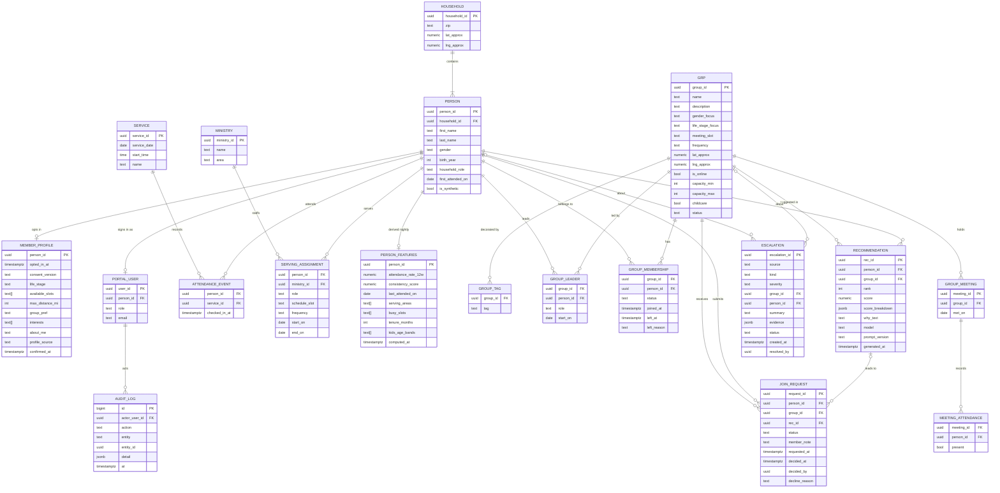

# Gathered: Data Model & Architecture v0.2
**v0.2 2026-11-02 (Walt's decisions applied) · v0.1 2026-11-02 · Hackathon build spec · Generic naming on purpose (Manager / Leader / Member, "group" not "D-Group" in the schema)**
**Companions:** `AI for Church Hackathon - Submission Deliverables.md` (form fields and safeguards) · `AI for Church Hackathon - Application.md`

---

## 0a · v0.2 decisions (2026-11-02, Walt). These override anything below that conflicts

| # | Decision |
|---|---|
| W1 | **Giving data is out.** It's not collected and not modeled. |
| W2 | **Group meetings and attendance stay in the model.** They're visible to the **Manager only**. They inform recommendations but are never shown in them. |
| W3 | **Recommendations surface no reasoning.** No "why it fits" text, no attendance, no person attributes. The member sees group cards (public group facts only) and validates the fit themselves. *Presentation guardrail: "Gathered recommends; the member decides. It never explains a recommendation in terms of a person."* Score breakdowns are stored for audit, visible to the Manager only. |
| W4 | **Minimal CRUD.** Groups, leaders, history and personas are seeded. The only writes in the demo: member intake (LLM-assisted profile), member requests to join, leader accepts or declines, manager acknowledges an escalation. |
| W5 | **Mock auth.** A landing page lists the personas. Choosing one "logs in" as that person, and every request carries that persona's ID into Postgres as the row-level security context. |
| W6 | **Three views.** Manager: group data and escalations. Leader: their assigned group, recent joiners, open requests. Member: not in a group → recommendations; in a group → group details only. |
| W7 | **Hosting:** Vercel free tier. **Data platform:** Databricks Free Edition, provisional on Walt's first-week experience. **Relational store:** Postgres. |
| W8 | **Escalations in the demo:** #1 hidden schedule conflict and #3 unmet demand / start a group. #2 and #4 are cut. |
| W9 | **Recommendations: Option A.** Hard filters, then a weighted score to a shortlist of about 6, then the LLM picks and orders the top 3 by comparing the member's own words with group descriptions and tags. The LLM returns group IDs plus an **internal rationale**. |
| W10 | **Internal rationale is Manager-audit only.** It never reaches a Leader or a Member. Leaders see only what the member chose to submit with a request. *Example of what must never surface to a leader:* "Joey would be great here; he's recently divorced and lonely." The rationale prompt is told to reference group facts and the member's stated preferences, and the audit view shows it so the demo can open the hood. |
| W11 | **Groups meet at the leader's home** (business rule). Group location = the leader's household location. **Hard filter: the member's household is within 5 miles** (haversine on approximate coordinates). Members see the general area (e.g. "near Lake Apopka, about 3 mi"), never an address. |
| W12 | **Seed geography: Winter Garden, FL (west of Orlando)**, using surrounding zips 34787, 34786, 34761, 34734 and 34711. Households get zip centroid plus random jitter. No real addresses. |
| W13 | **Defaults accepted:** group cards show public group facts only (same for every member); one-screen LLM-assisted intake with member confirmation; one-button leader accept/decline; Claude Haiku via OpenRouter for intake and ranking, Sonnet for escalation review. |


## 0 · Decisions this spec makes (v0.1; see 0a for overrides) (change them here, not in code)

| # | Decision | Why |
|---|---|---|
| D1 | **Two stores.** Postgres is the system of record for the app (groups, memberships, requests, profiles, recommendations). The data platform holds engagement history and computes person features | This is the split every commercial client has: an operational CRM/app plus an analytical warehouse. Writing join requests into a warehouse from a web app is slow and has no enforced keys |
| D2 | **Recommendations are computed on demand in Postgres** from current memberships + nightly person features | Flow step 5 (a group changes when someone joins) must show up immediately in the demo. A nightly batch would hide it |
| D3 | **Matching is deterministic. The LLM never picks the group.** The LLM handles intake (free text → profile fields), the "why it fits" text, and escalation review | Accuracy and explainability; the safeguards we committed to |
| D4 | **Giving data is not in the model at all** | Simpler and stronger than masking it. *Update the Submission Deliverables safeguard row to "not collected."* |
| D5 | **Permissions are enforced with Postgres row-level security**, keyed on the signed-in portal user | "Enforced where the data lives, not in the UI" stays true without the Copilot surface |
| D6 | **Synthetic church only**, every row flagged `is_synthetic = true` | Hackathon rule plus our safeguard |
| D7 | **Kids are person rows with `household_role = 'child'`** and no portal account | Needed for "has kids under 5" matching without a separate table |

---

## 1 · The layers

```
┌───────────────────────────────────────────────────────────────┐
│ PORTAL (Next.js)    Member · Leader · Manager                 │
│   server routes ──► LLM via OpenRouter (key server-side only) │
├───────────────────────────────────────────────────────────────┤
│ OPERATIONAL STORE (Postgres + row-level security)             │
│   groups · memberships · join requests · member profiles      │
│   recommendations · escalations · audit log                   │
│   fn recommend_groups(person) — scored live                   │
├──────────────▲────────────────────────────────────────────────┤
│              │ nightly: person_features synced in             │
│ DATA PLATFORM (lakehouse tables)                              │
│   attendance events · serving assignments · services          │
│   job: compute person_features · job: rule-based escalations  │
└───────────────────────────────────────────────────────────────┘
```

If the stack is Databricks, the Postgres layer can be **Lakebase** (Databricks' managed Postgres; Free Edition allows one project with scale-to-zero). Fallback: Neon or Supabase free tier. **Verify in week 1:** whether Lakebase synced tables (Delta → Postgres) work in Free Edition; if not, the nightly job writes `person_features` with a plain insert.

---

## 2 · Entity diagram

See `Gathered - ER Diagram.png` (source below).



---

## 3 · Tables by layer

### 3a · People (operational, seeded)
- **household**: location is **approximate** (zip centroid plus jitter). Never a street address.
- **person**: adults and children. `household_role` = `adult` | `child`. `gender` is used only to honor gender-focused groups (D-Groups are often same-gender).
- **member_profile**: exists **only if the person opted in**. Everything the matcher uses about preferences comes from here, in the member's own words or confirmed by them.
  - `life_stage`: self-reported enum: `single` · `married_no_kids` · `young_kids` · `school_age_kids` · `teens` · `empty_nest` · `retired`.
  - `available_slots`: e.g. `{sun_pm, tue_eve, thu_am}`. `group_pref`: `men` · `women` · `mixed` · `couples`.
  - `about_me`: free text. The LLM proposes structured fields from it, the member confirms (`profile_source = 'llm_confirmed'`).
- **portal_user**: `role` = `member` · `leader` · `manager`. A leader is also a member.

### 3b · Engagement (data platform, seeded history 26 weeks) — **v0.3 attendance-signal model (2026-11-03)**
**Principle:** a church never sees everyone who attends. Attendance is a set of *signals* with uneven coverage, and **no signal is not absence**.

| Channel (`attendance_event.channel`) | What it records | Who it covers |
|---|---|---|
| `kiosk` | Child check-in. `person_id` = child, `checked_in_by` = the adult who checked them in | Families with kids ≤12 who use the kiosk (seed: about 88% of those families) |
| `app_geofence` | An "arrived on campus" event from the church app | Only households with `household.checkin_app_opt_in = true` (seed: about 21%). Consent is recorded and **no location trail is stored**, only the arrival event |
| `serving_roster` | The adult was rostered to serve that slot (serving implies presence) | Volunteers (weekly, biweekly or monthly) |
| `livestream` | A logged-in viewing session with `minutes_watched`; one row per household | Online and hybrid households. It counts as attended at **20+ minutes** |

- **Not modeled:** usher headcounts (anonymous) and connect cards. We do **not** assume every family has a geofenced app.
- **Seed reality:** 120 of 331 adults (36%) leave no attendance trace at all, even though many attend. Examples: the spouse who didn't check the kids in, singles without the app, and the second adult in a livestream household.
- **Tables:**
  - `service`: two Sunday services (9:00, 11:00; the 11:00 is livestreamed) and Wednesday night. Columns added: `slot`, `livestreamed`.
  - `attendance_event`: `person_id`, `service_id`, `channel`, `checked_in_by`, `checked_in_at`, `minutes_watched`.
  - `ministry`, `serving_assignment`: `schedule_slot` (e.g. `sun_11`) is what makes the "kids-ministry volunteer arrives late" conflict detectable.
- **person_features** (derived nightly in Databricks, synced to Lakebase):
  - `observed_weeks_12w`: weeks with any signal, counting the adult on a kiosk row's `checked_in_by`
  - `attendance_rate_12w`: of observed signals only
  - `signal_sources`: the channels seen for this person
  - **`signal_confidence`**:
    - `high`: any kiosk, app or weekly-serving signal in the last 8 weeks
    - `medium`: livestream or occasional serving only
    - `low`: no signals
  - `online_share_12w`: share of observed weeks that were livestream
  - `consistency_score`, `busy_slots`, `serving_areas`, `kids_age_bands`, `tenure_months`
- **Matching guardrail:**
  - The consistency factor (15 pts) applies **only at `high` or `medium` confidence**. At `low` it scores neutral (7.5).
  - A low observed rate is never treated as low commitment.
  - `online_share_12w` ≥ 0.75 marks an **online-first** member: online groups stay eligible, and the manager dashboard can show "online-first households within 5 miles of an in-person group."
- **Validation:** `_truth_household.csv` / `_truth_person.csv` hold the generator's hidden truth (online mode, kiosk use, propensity, drift). They're used to check that the features notebook recovers it. **Never loaded into the app.**

### 3c · Groups (operational)
- **grp**: `status` = `forming` · `open` · `full` · `closed` · `multiplying`. `capacity_max` defaults to 8 and `capacity_min` to 3 (D-Group sizing).
- **group_tag**: free-form decoration the manager adds ("new to faith," "Bible-reading plan," "dads," "recovery-friendly").
- **group_leader**, **group_membership**: membership is the only thing that changes a group's makeup (flow step 5).
- **group_meeting**, **meeting_attendance**: optional for v1. Needed only for "group shrinking" escalations. **Cut first if time is short.**

### 3d · Workflow and governance (operational)
- **recommendation**: one row per person, group and generation run.
  - `score_breakdown` holds each factor's points, so the "why" is traceable.
  - `why_text` is the LLM sentence, generated *from* the breakdown.
- **join_request**: `status` = `requested` · `accepted` · `declined` · `withdrawn` · `expired`. Accepting a request inserts the membership in the same transaction.
- **escalation**: `source` = `rule` | `ai`.
  - `evidence` stores the facts the escalation was built from. For AI escalations, store the model and prompt version too.
- **audit_log**: every accept, decline, profile confirm, escalation resolve, and LLM call.

### 3e · Derived view: `group_profile` (makes step 5 work)
Computed live from active memberships joined to `person_features` and `member_profile`:
- headcount and open seats
- life-stage mix and kids-age-band mix
- serving areas represented
- median consistency
- the meeting slot

When the first dad of toddlers joins an empty "forming" group, the group's `kids_age_bands` change from `{}` to `{0-4}`, and the next dad of toddlers scores higher. No batch job is needed.

---

## 4 · Who sees what (row-level security)

| Data | Member | Leader | Manager |
|---|---|---|---|
| Own profile, recommendations, requests | ✔ read/write | ✔ (as a member) | ✔ |
| Group public card (name, description, tags, slot, area, open seats) | ✔ | ✔ | ✔ |
| A group's member list | ✖ | **own groups only** | ✔ all |
| Join requests | own only | **requests to own groups** | ✔ all |
| A requester's profile summary | ✖ | **only while they have a pending request to the leader's group** | ✔ |
| Engagement history, service attendance, **group meeting attendance** | ✖ | ✖ | ✔ (Manager only) |
| Recommendation score breakdown | ✖ | ✖ | ✔ audit only |
| Escalations | ✖ | about own groups | ✔ all |

The two-role demo clip becomes **Leader vs. Manager** asking for the same screen.

---

## 5 · Matching v1 (deterministic, explainable)

**Hard filters (a group is excluded if any fail):**
- **Opt-in:** the person has an opted-in profile.
- **Seats:** group status is `forming` or `open`, and there are seats left.
- **Gender focus:** compatible with the person.
- **Schedule:** the meeting slot is in the person's `available_slots` **and** not in their `busy_slots`.
- **Distance:** the member's household is within **5 miles of the leader's household** (W11), unless the group is online.

**Weighted score (0–100):**

| Factor | Points | Source |
|---|---|---|
| Life stage matches the group's focus, or its current members' mix | 30 | profile vs `group_profile` |
| Kids-age overlap with current members | 20 | `kids_age_bands` |
| Shared serving area with a member or leader | 15 | `serving_areas` |
| Consistency similar to the group's median | 15 | `consistency_score` |
| Interest or tag overlap | 10 | `interests` vs `group_tag` |
| Distance within the 5-mile radius (closer is better) | 10 | approximate coordinates of member vs leader household |

- **Shortlist:** the top ~6 by score go to the LLM, which returns the final top 3 and an internal rationale (W9/W10).
- ~~The LLM writes the "why"~~ **Removed (W3).** Members see group cards only.
- **Forming groups** with zero members fall back to the group's declared focus, so new groups still get recommended.

---

## 6 · Where the LLM is used (three jobs, all server-side)

| Job | Trigger | Input | Output | Guardrail |
|---|---|---|---|---|
| **Intake** | Member saves "about me" | Free text | Proposed profile fields (JSON schema) | Member confirms every field; nothing is saved unconfirmed. Sensitive disclosures route to escalation, not to the profile (see §7) |
| ~~Why it fits~~ | **Removed (W3).** See open decision B1 on the LLM's role in ranking | | | |
| **Escalation review** | Join request created, plus nightly | Structured facts + group description + member note | `{raise: bool, kind, severity, summary, evidence[]}` | Advisory only; the manager decides. Every call logged |

**Library:** the OpenAI-compatible SDK pointed at OpenRouter, or the Vercel AI SDK `generateObject` with a zod schema. **No LangChain:** these are three single-shot structured calls with no agent loop.

---

## 7 · Escalations

**Deterministic (rules, nightly job):**
- Group below `capacity_min` for 4+ weeks
- Join request undecided after 7 days
- Group full while requests keep arriving
- Leader leads more than 2 groups

**AI-reviewed (cases rules can't read):**
1. **Hidden schedule conflict.** The group description says "we meet right after second service," and the requester serves in kids' ministry at 11:00, or wrote "I help in the nursery most Sundays" in `about_me`. Neither is a clean structured slot match, so the LLM reads both texts plus `busy_slots`. *Manager gets:* "Marcus may arrive 30–40 min late every week."
2. **Needs care, not just a group.** The member's own words in `about_me` or the request note suggest a crisis or a pastoral need ("my wife just left," "just got out of rehab").
   - Gathered routes it to the manager, and stores no label on the person.
   - If there's crisis language, the member sees crisis resources immediately. That trigger is deterministic plus the LLM.
3. **Unmet demand, or a group to start.**
   - Clusters recent requests and profiles that got no good match ("6 moms of toddlers want a weekday morning group; none exists").
   - Suggests starting one, and names a possible leader from people with consistent attendance, serving history and 12+ months of tenure.
   - This is the multiplication step in the D-Group model.
4. **Group drift.** A group's description says "young dads," but its membership has shifted to empty nesters, so recommendations no longer fit the description. *Prompt to the leader and manager:* update the description.

**Decided (W8): build 1 and 3 for the demo. 2 and 4 are cut.**

---

## 8 · Synthetic church (seed spec) — superseded by seed v0.2; see 8a

- **Size:** one church, about 160 households and 420 people (including about 110 children), with 26 weeks of attendance and 6 ministries.
- **Groups:** 12 in total.
  - 2 forming and empty
  - 6 open
  - 2 full
  - 2 under the 3-person minimum (they trigger the escalation)
- **Staff:** 1 manager and 8 leaders.
- **Opted-in members:** 60, including 20 not in any group.
- **Demo personas (seeded on purpose, with names clearly fictional):**
  - *Marcus*: dad of two under 5, serves kids' ministry at 11:00, available Sunday PM and Tuesday evening (the conflict story).
  - *Dana*: new attender for 6 weeks, single, consistent, interested in a Bible-reading plan.
  - *Ruth*: empty nester, 9 years at the church, high consistency (leader candidate for the unmet-demand story).
  - Plus a cluster of moms of toddlers with no weekday morning group.
- **Data flags:** every row has `is_synthetic = true`. Locations are zip centroids.

---

## 9 · Open questions

1. **Lakebase in Free Edition:** do synced tables and row-level security work there? If not, use Neon or Supabase.
2. **Hosting the Next.js app.** Check the terms on each option:
   - Vercel Hobby and Databricks Free Edition are both licensed for non-commercial use.
   - Databricks Apps on Free Edition stop after 24 hours.
   - Judges need it live Nov 28–30.
3. **Authentication for the demo:** seeded logins for the three roles plus a judge account. No real accounts.
4. **Group meetings and attendance tables:** keep them, or cut them to protect hours?

---

## 10 · Postgres validation spike (timebox 45 minutes)

**Goal:** decide where the operational store lives. Run Lakebase first; if any must-pass item fails, switch to Neon without regret.

| # | Test | Must pass? |
|---|---|---|
| P1 | A Lakebase project can be created in Free Edition | Yes |
| P2 | Vercel serverless (or a local script standing in for it) can connect from outside Databricks with a **stable credential**: a native Postgres role and password, not a 1-hour OAuth token | Yes |
| P3 | Row-level security works with a per-request setting (`SET app.person_id`), so the three personas see different rows | Yes |
| P4 | Cold start after scale-to-zero is under ~5 seconds | Yes (judges will hit it cold) |
| P5 | A synced table from a Delta table into Lakebase works for `person_features` | Nice to have. If not, a nightly notebook writes it |

**Fallback: Neon free tier** (native Vercel integration, standard Postgres, RLS supported).
- Feature sync becomes a Vercel scheduled job that **pulls** from the Databricks SQL Statement API, which is inbound to Databricks. A Databricks job may not be able to push outbound to Neon, because Free Edition limits outbound internet access.
- **Test P6:** the Databricks SQL API answers a query using a personal access token.

**Not chosen: Supabase free.** It pauses inactive projects, which is a risk if the app sits idle before judging.

### 10a · Results (2026-11-02): **Lakebase chosen**
- **P1:** project `gathered-demo` created in Free Edition. PASS. Postgres 17.11.
- **P2:** outside connection as `gathered_app` with a native password: PASS (381 ms).
- **P3:** RLS for leader, member, manager and no-context: ALL PASS (2/1/3/0 rows).
- **P4:** 381 ms on a connection that was probably warm. **Rerun after 10+ minutes idle** to confirm a true cold start.
- **P5** (synced tables) and **P6** (Databricks SQL API): not yet tested. Not blocking. A nightly notebook can write `person_features` into Lakebase directly, since both live inside Databricks.
- **Decision:** Lakebase replaces the Neon fallback. `gathered_app` has LOGIN only (no superuser, CREATEDB, CREATEROLE or BYPASSRLS). The owner role runs migrations and seeds. Drop schema `spike` once the real schema is in.

---

## 8a · Seed v0.2 (2026-11-03)
- **Size:**
  - 187 households, 546 people (331 adults, 215 children)
  - 20 groups: 2 forming, 2 full, 2 under the minimum
  - 69 opted-in profiles
- **Attendance:** 3,929 events over 26 weeks:
  - 1,759 kiosk
  - 1,167 app
  - 718 livestream
  - 285 serving roster
  - The count is lower than v0.1 despite a bigger church, because the signals are now realistic.
- **Hard-filter results:** unmatched opted-in members now reach up to 7 eligible groups. Marcus 5, Dana 7, Jordan 6 after intake, Priya 0 on purpose.
- **Near-duplicate groups** the LLM must tell apart by description:
  - Dana cluster (Wed/Thu): Deep Roots, Thursday Women in the Word, Midweek Prayer & Worship, Online Thursday Study, all alongside First Steps.
  - Marcus cluster (Tue/Sun PM): Tuesday Men's Accountability, Men of Iron, Sunday Supper Families, alongside Tuesday Night Dads and Sunday Lunch.
- **New personas:**
  - **Chris** (leader of the forming men's group)
  - **Jordan** (new, **no profile**: live intake demo. Suggested intake text is in `personas.json`)
  - **Sam**: has a pending request to Chris's group. When Chris accepts, the group's kids-age mix changes and Jordan's ranking for it shifts (flow step 5).
- **Escalation #3 strengthened:** Clermont Moms Morning exists but is about 12 miles from Priya, so the nearest weekday-morning moms' group is outside the radius.
- **`eval_label.csv`:** 14 labeled members (12 designed plus Marcus and Dana), each with an expected group and a cue in `about_me`. The expected group passes the hard filters for 14 of 14, so the number we report measures the LLM's ranking, not the filters.
- **Fixed:** personas drawn at random as leaders or members, the manager having a profile, empty CSVs without headers, duplicate profiles.
